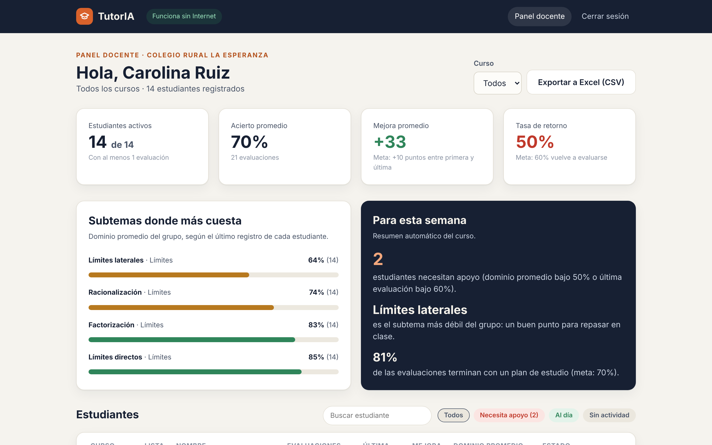
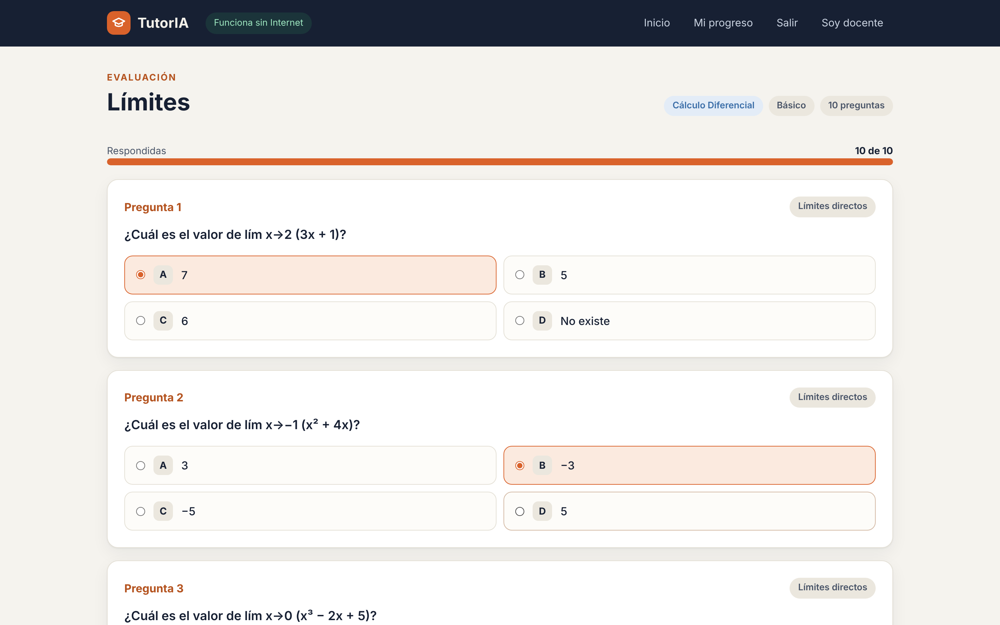
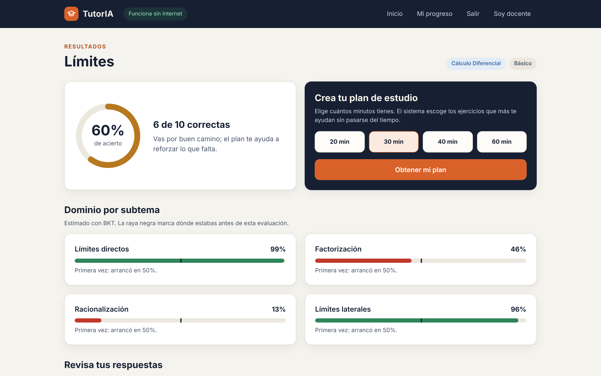
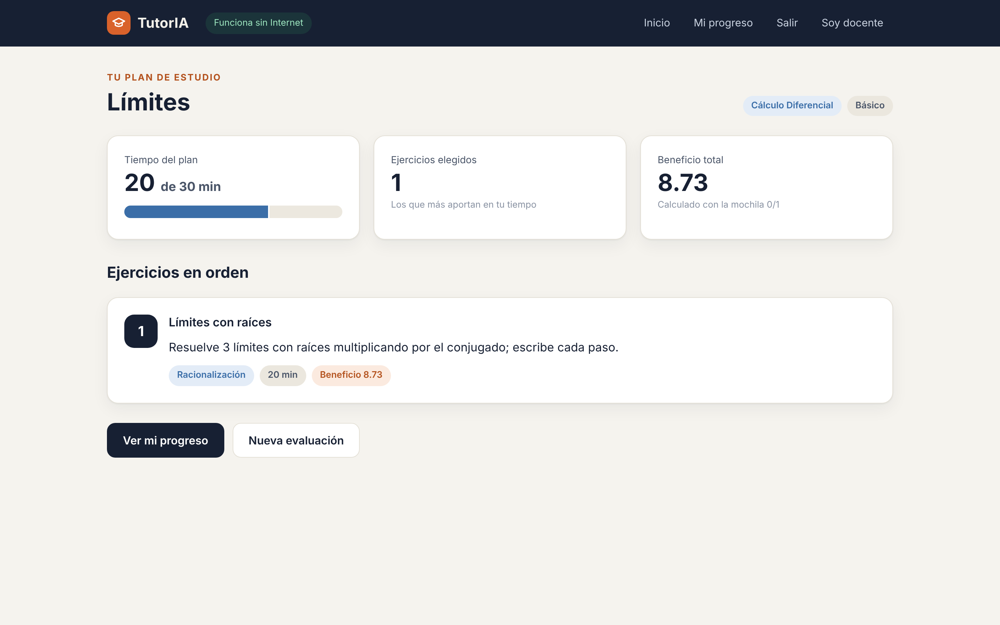
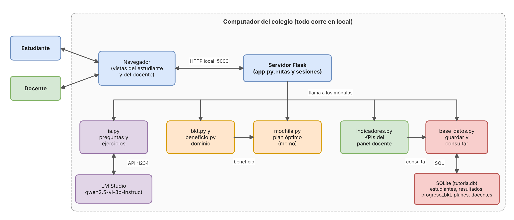

# TutorIA

**Tutoría personalizada que funciona sin conexión continua a Internet.**

TutorIA es una aplicación web que corre completa en el computador de un colegio. Un modelo de lenguaje local genera las evaluaciones, Bayesian Knowledge Tracing (BKT) estima cuánto domina el estudiante cada subtema y una mochila 0/1 con programación dinámica arma el mejor plan de estudio para los minutos que tiene. El docente ve el avance de su curso en un panel con indicadores.

Proyecto del curso Diseño de Datos y Algoritmos, Escuela Colombiana de Ingeniería Julio Garavito. ODS 4: Educación de calidad.



## Por qué

En Colombia solo el 41,9 % de los hogares rurales tiene Internet, frente al 72,5 % en las cabeceras (DANE, 2024), y el 69,4 % de las sedes educativas rurales no tiene conexión (LEE Javeriana, 2024). Casi todas las plataformas de práctica adaptativa viven en la nube. TutorIA lleva el modelo del estudiante, la recomendación y la IA al mismo computador, para que la falta de señal no deje a nadie sin práctica personalizada.

## Qué hace

**Estudiante**
- Se registra con colegio, curso y número de lista, sin correo ni cuenta externa.
- Presenta una evaluación de 10 preguntas generada por la IA local.
- Ve su dominio por subtema y cómo cambió frente a la sesión anterior.
- Recibe un plan de ejercicios para 20, 30, 40 o 60 minutos. Los subtemas que ya domina (95% o más) no entran al plan.
- Consulta su historial y la evolución de cada subtema.

**Docente**
- Crea una cuenta (la contraseña se guarda con hash) y ve solo los estudiantes de su colegio.
- Panel por curso con estudiantes activos, acierto promedio, mejora, tasa de retorno y uso del plan.
- Subtemas más débiles del grupo y estudiantes que necesitan apoyo.
- Buscador por nombre y filtros por estado (necesita apoyo, al día, sin actividad).
- Detalle de cada estudiante y exportación a CSV para abrir en Excel.

| Evaluación | Resultados | Plan de estudio |
|---|---|---|
|  |  |  |

## Cómo funciona



El navegador solo habla con un servidor Flask local. `ia.py` es el único módulo que se comunica con LM Studio y `base_datos.py` el único que toca SQLite.

**Dominio con BKT.** Después de cada respuesta se aplica la regla de Bayes con descuido s = 0,1, adivinanza g = 0,2 y aprendizaje l = 0,1. Un error no hunde al estudiante y un acierto no lo vuelve experto. El beneficio de reforzar un subtema es (1 − P) × 10.

**Plan con mochila 0/1.** Cada ejercicio tiene un tiempo y un beneficio, y hay T minutos. M(i, r) es el mejor beneficio con los ejercicios desde i y r minutos restantes:

```
M(n, r) = 0
M(i, r) = max( M(i+1, r), b_i + M(i+1, r − t_i) )   si t_i ≤ r
```

Se resuelve top-down con memorización en O(n·T), frente a O(2ⁿ) de la fuerza bruta. Un algoritmo voraz no sirve porque en la mochila 0/1 no garantiza el óptimo.

## Instalación

Requisitos: Windows, macOS o Linux con Python 3.10 o superior y [LM Studio](https://lmstudio.ai/).

1. En LM Studio, descargue el modelo `qwen2.5-vl-3b-instruct` (cuantización Q4_K_M, unos 3,3 GB), cárguelo y encienda el servidor local en el puerto 1234.
2. Instale las dependencias:
   ```
   pip install -r requirements.txt
   ```
3. Inicie la aplicación:
   ```
   python app.py
   ```
   En Windows también puede hacer doble clic en `iniciar.bat`.
4. Abra http://127.0.0.1:5000 en el navegador.

Para probar la conexión con LM Studio antes de empezar: `python probar_lm_studio.py`.

La base de datos `data/tutoria.db` se crea sola la primera vez. Para usar el panel docente, entre a **Soy docente** y escriba el nombre del colegio igual que los estudiantes.

## Estructura

```
TutorIA/
├── app.py               Servidor Flask y rutas
├── ia.py                Conexión con LM Studio y esquemas JSON
├── bkt.py               Bayesian Knowledge Tracing
├── beneficio.py         Beneficio de reforzar cada subtema
├── mochila.py           Mochila 0/1 top-down con memorización
├── base_datos.py        Tablas y consultas en SQLite
├── indicadores.py       KPIs del panel docente
├── templates/           Vistas HTML
├── static/css/          Estilos (sin recursos de Internet)
├── data/                Base de datos local (no se sube al repositorio)
├── simulacion/          Evaluación con 100 estudiantes simulados
└── docs/                Paper, diagramas y capturas
```

## Resultados

Evaluamos el sistema con 100 estudiantes simulados que usan el código real (`simulacion/`). Cada uno tiene un dominio oculto por subtema y responde con probabilidades propias de descuido y adivinanza.

| Indicador | Resultado | Meta |
|---|---|---|
| Plan igual a la fuerza bruta | 200 de 200 casos | 100 % |
| Tiempo del plan | 0,42 ms en el peor caso real | < 2 s |
| Calidad del BKT (AUC) | 0,95 | ≥ 0,80 |
| Ventaja del plan frente a repasar sin guía | entre 1,3 y 6,1 puntos según la cohorte | ≥ 10 puntos |

El plan siempre ayuda, pero la meta de 10 puntos no se alcanza en simulación y debe confirmarse con una prueba piloto con estudiantes reales. El detalle está en el [paper](docs/Paper_TutorIA.pdf).

Para repetir la simulación:

```
pip install numpy scipy matplotlib
cd simulacion
python simulacion.py ..
python robustez.py ..
python graficas.py
```

## Limitaciones y trabajo futuro

- Prueba piloto con estudiantes reales para validar el aprendizaje.
- Banco local de preguntas que sirva de respaldo si la IA falla y evite repetir preguntas.
- Instalador de un solo clic para colegios sin personal técnico.
- Ajustar los parámetros del BKT con datos reales.

## Equipo

Juan Pablo León · Mateo Barrios · Santiago Lugo · Alejandro Peña

Escuela Colombiana de Ingeniería Julio Garavito, 2026.
