<div align="center">

# TutorIA

**Tutoría personalizada con IA local, BKT y una mochila 0/1, para estudiar sin conexión continua a Internet.**

[](https://github.com/SantiagoLugoGomez/Proyecto-ODS-4-Extasys-Code-/actions/workflows/ci.yml)


[](LICENSE)


[Paper](docs/Paper_TutorIA.pdf) · [Sustentación](docs/Sustentacion_TutorIA.pptx) · [Instalación](#instalación) · [Resultados](#resultados) · [Reproducir el paper](#reproducir-los-resultados-del-paper)

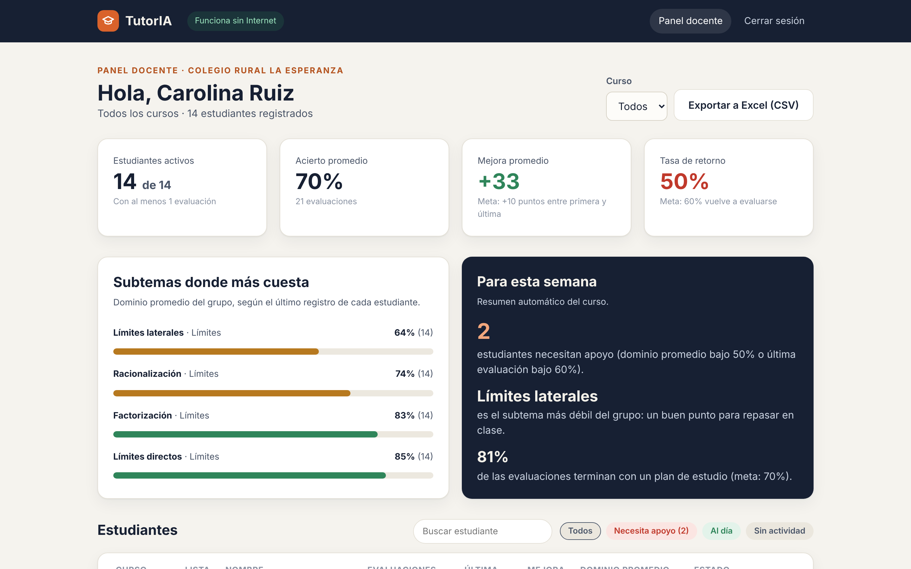

</div>

TutorIA es una aplicación web que corre completa en el computador de un colegio. Un modelo de lenguaje local genera las evaluaciones, **Bayesian Knowledge Tracing (BKT)** estima cuánto domina el estudiante cada subtema y una **mochila 0/1 con programación dinámica** arma el mejor plan de estudio para los minutos que tiene. El docente sigue a su curso en un panel con indicadores. Ningún dato sale del computador.

Proyecto del curso **Diseño de Datos y Algoritmos** de la Escuela Colombiana de Ingeniería Julio Garavito, alineado con el **ODS 4: Educación de calidad** (metas 4.5 y 4.1).

## Contenido

- [El problema](#el-problema)
- [Qué hace](#qué-hace)
- [Cómo funciona](#cómo-funciona)
- [Instalación](#instalación)
- [Resultados](#resultados)
- [Reproducir los resultados del paper](#reproducir-los-resultados-del-paper)
- [Desarrollo y pruebas](#desarrollo-y-pruebas)
- [Estructura del repositorio](#estructura-del-repositorio)
- [Límites y trabajo futuro](#límites-y-trabajo-futuro)
- [Equipo y cómo citar](#equipo)

## El problema

| Dato | Fuente |
|---|---|
| Solo el **41,9 %** de los hogares de centros poblados y rural disperso tenía Internet en 2024, frente al 72,5 % en las cabeceras. | DANE, ENTIC Hogares 2024 |
| El **69,4 %** de las sedes educativas rurales no tiene Internet. | LEE, Pontificia Universidad Javeriana, 2024 |
| En Saber 11 de 2023 los colegios rurales obtuvieron **25,2 puntos menos** que los urbanos (231,8 frente a 257,0). | LEE, Pontificia Universidad Javeriana, 2024 |

Las plataformas de práctica adaptativa viven en la nube, así que quienes no tienen una conexión estable quedan por fuera justo de la ayuda que más necesitan. TutorIA lleva el modelo del estudiante, la recomendación y la IA al mismo computador.

## Qué hace

**Estudiante**

- Se registra con colegio, curso y número de lista, sin correo ni cuenta externa.
- Presenta una evaluación de 10 preguntas de 4 opciones creada por la IA local (3 + 3 + 2 + 2 por subtema).
- Ve su dominio por subtema y cuánto cambió frente a la sesión anterior.
- Recibe un plan de ejercicios para 20, 30, 40 o 60 minutos. Los subtemas que ya domina (95 % o más) no entran al plan.
- Consulta su historial y la evolución de cada subtema.

**Docente**

- Crea una cuenta (la clave se guarda con hash) y ve solo los estudiantes de su colegio.
- Panel por curso con estudiantes activos, acierto promedio, mejora, tasa de retorno y uso del plan.
- Subtemas más débiles del grupo y estudiantes que necesitan apoyo, con buscador y filtros.
- Detalle de cada estudiante y exportación a CSV para abrir en Excel.

| Evaluación | Resultados | Plan de estudio |
|---|---|---|
| 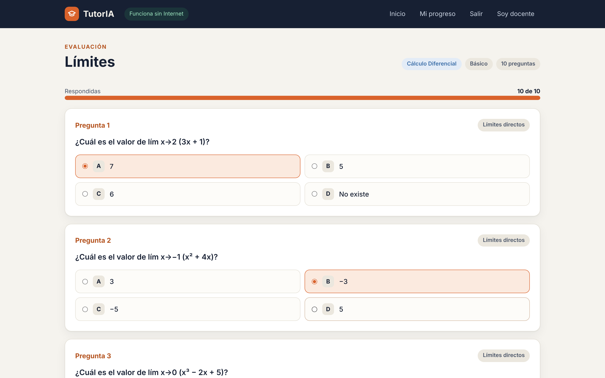 | 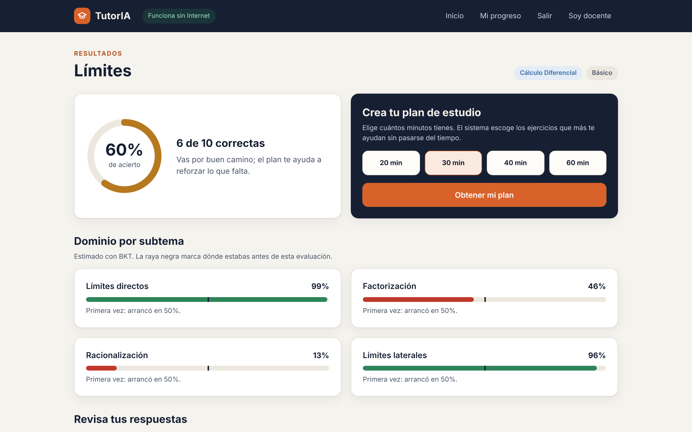 | 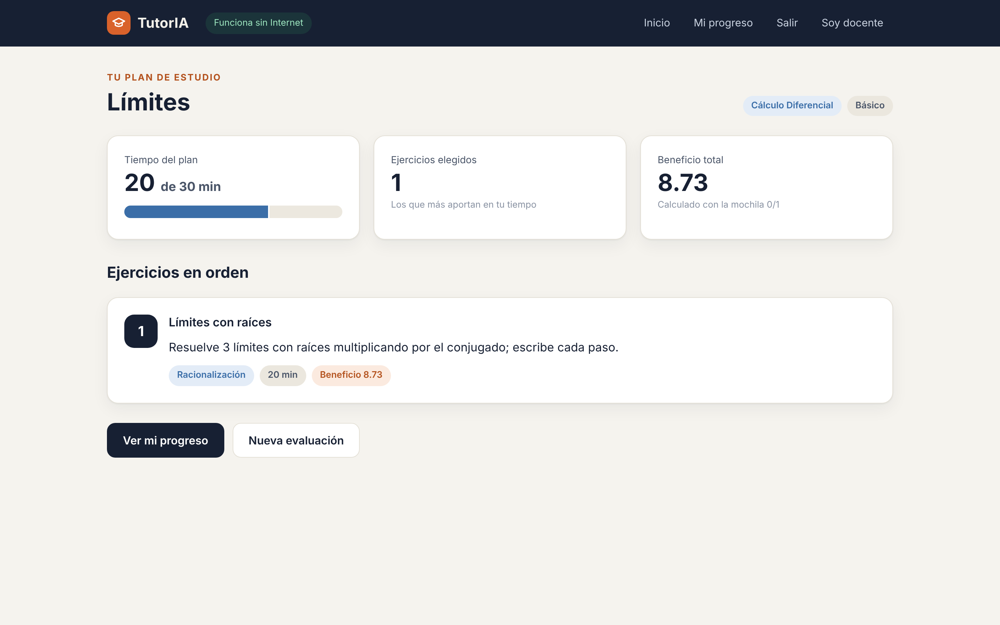 |

Materias incluidas: **Cálculo diferencial** (límites, derivadas), **Inglés** (verb to be, present simple, past simple) y **Física** (vectores, movimiento, leyes de Newton). También se puede escribir cualquier otro tema.

## Cómo funciona

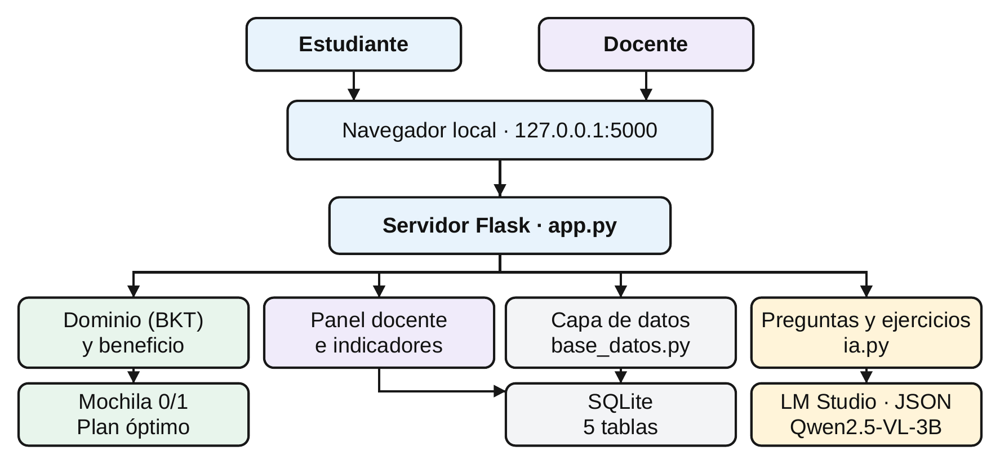

El navegador solo habla con un servidor Flask local. `ia.py` es el único módulo que se comunica con LM Studio y `base_datos.py` el único que lee y escribe en SQLite. El servidor de LM Studio recibe un esquema JSON y restringe la generación a ese formato: la IA genera contenido, pero no toma decisiones de evaluación ni de planificación.

<details>
<summary><b>Secuencia de una sesión, flujo completo y casos de uso</b></summary>

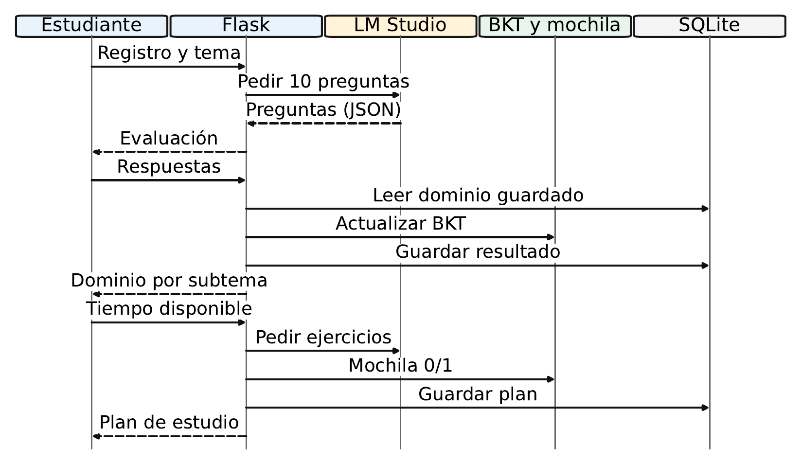

| Flujo de evaluación y planificación | Recurrencia de la mochila con memoización |
|---|---|
| 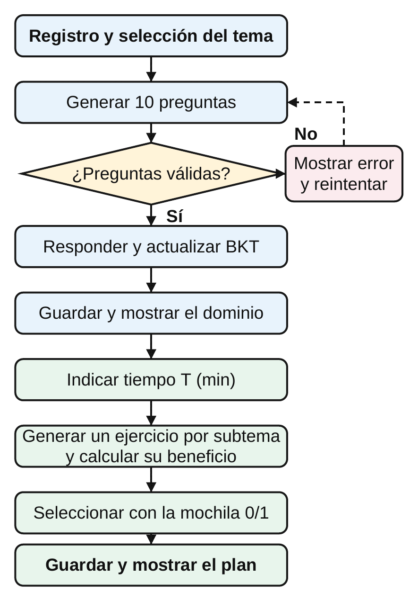 | 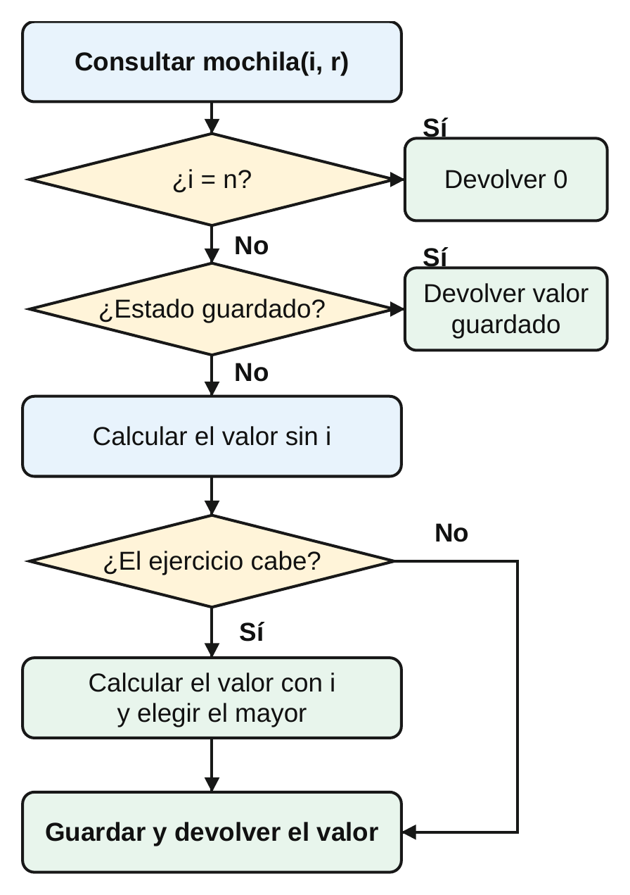 |

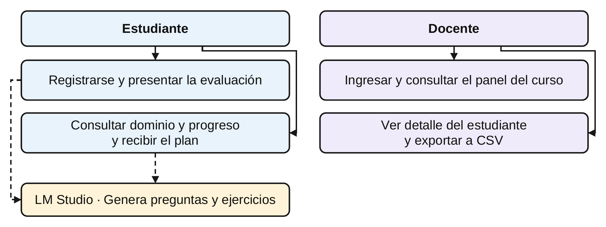

</details>

### 1. Dominio con BKT

Cada subtema nuevo empieza en $P_0 = 0{,}5$; si ya se trabajó, parte del último valor guardado. Con cada respuesta se aplica la regla de Bayes, con descuido $s = 0{,}1$ y adivinanza $g = 0{,}2$, y luego la transición de aprendizaje $\ell = 0{,}1$ ([`bkt.py`](bkt.py)):

$$
P^{*} = \frac{P(1-s)}{P(1-s) + (1-P)\,g}\ \text{(acierta)} \qquad
P^{*} = \frac{P\,s}{P\,s + (1-P)(1-g)}\ \text{(falla)} \qquad
P^{+} = P^{*} + (1-P^{*})\,\ell
$$

Con acierta, acierta, falla, acierta, acierta el dominio pasa por 0,5 → 0,8364 → 0,9625 → 0,7861 → 0,9487 → 0,9893: un error no hunde al estudiante y un acierto no lo vuelve experto de inmediato.

### 2. Beneficio

El beneficio de reforzar un subtema es $b = 10\,(1 - P)$ ([`beneficio.py`](beneficio.py)): mientras menos lo domine, más vale practicarlo.

### 3. Plan óptimo con mochila 0/1

Hay $n$ ejercicios candidatos, cada uno con duración $t_i$ y beneficio $b_i$, y $T$ minutos. $M(i, r)$ es el mayor beneficio con los candidatos desde $i$ y $r$ minutos restantes ([`mochila.py`](mochila.py)):

$$
M(i, r) =
\begin{cases}
0 & i = n \\
M(i+1, r) & t_i > r \\
\max\{\,M(i+1, r),\ b_i + M(i+1, r - t_i)\,\} & \text{en otro caso}
\end{cases}
$$

Se resuelve top-down y cada estado $(i, r)$ se guarda en un diccionario, así que hay a lo sumo $(n+1)(T+1)$ estados: **tiempo y espacio $O(n\cdot T)$**, frente a $O(2^n)$ de la fuerza bruta.

**Por qué no un voraz.** Ejemplo de la Tabla 5 del paper, con 30 minutos (`python mochila.py` lo reproduce):

| Subtema | Aciertos | Dominio P | Beneficio b | Tiempo |
|---|---|---|---|---|
| Límites directos | 3 de 3 | 0,992 | 0,08 | 10 min |
| Factorización | 1 de 3 | 0,184 | 8,16 | 15 min |
| Racionalización | 0 de 2 | 0,127 | 8,73 | 20 min |
| Límites laterales | 2 de 2 | 0,963 | 0,37 | 15 min |

La mochila escoge Racionalización y Límites directos (beneficio 8,80); el voraz por beneficio por minuto toma Factorización y Límites laterales (8,53).

## Instalación

**Requisitos:** Windows, macOS o Linux con [Python 3.10 o superior](https://www.python.org/downloads/) y [LM Studio](https://lmstudio.ai/). Se necesita Internet solo para la instalación; después todo funciona sin conexión.

1. **Modelo local.** En LM Studio descargue `qwen2.5-vl-3b-instruct` (cuantización Q4_K_M, unos 3,3 GB), cárguelo y encienda el servidor local en el puerto 1234 (pestaña *Developer*).
2. **TutorIA.** Descargue el repositorio ([zip](https://github.com/SantiagoLugoGomez/Proyecto-ODS-4-Extasys-Code-/archive/refs/heads/main.zip) o `git clone`) y ejecute el lanzador:
   - **Windows:** doble clic en `iniciar.bat`.
   - **macOS / Linux:** `./iniciar.sh`

   La primera vez crea un entorno virtual en `.venv` e instala las dependencias; luego abre el navegador en http://127.0.0.1:5000.
3. **Docentes:** entre a *Soy docente* y escriba el nombre del colegio igual que lo escriben sus estudiantes.

<details>
<summary><b>Instalación manual</b></summary>

```bash
python -m venv .venv
```

```bash
.venv/bin/pip install -r requirements.txt     # Windows: .venv\Scripts\pip install -r requirements.txt
```

```bash
.venv/bin/python app.py                       # Windows: .venv\Scripts\python app.py
```

</details>

**Verificar LM Studio:** `python probar_lm_studio.py` revisa la conexión, comprueba que el modelo esté cargado y genera una evaluación de prueba. Si LM Studio no responde, la aplicación muestra el problema y un botón **Reintentar**, sin perder los datos del formulario.

### Configuración

Todo funciona sin configurar nada. Para casos especiales se usan variables de entorno ([`config.py`](config.py)):

| Variable | Por defecto | Para qué |
|---|---|---|
| `TUTORIA_LM_URL` | `http://localhost:1234/v1` | Dirección del servidor de LM Studio |
| `TUTORIA_MODELO` | `qwen2.5-vl-3b-instruct` | Modelo cargado en LM Studio |
| `TUTORIA_INTENTOS_IA` | `2` | Intentos si la IA genera contenido inválido |
| `TUTORIA_TIEMPO_ESPERA_IA` | `300` | Segundos máximos de espera por respuesta |
| `TUTORIA_HOST` / `TUTORIA_PUERTO` | `127.0.0.1` / `5000` | Dónde escucha la aplicación (use `0.0.0.0` para abrirla desde otros equipos de la sala) |
| `TUTORIA_DATA` | `data/` | Carpeta de la base de datos SQLite y de la clave de sesión |
| `TUTORIA_DEBUG` | `0` | `1` activa el modo de depuración de Flask (solo para desarrollo) |

La base `data/tutoria.db` y la clave que firma las sesiones se crean solas la primera vez y nunca se suben al repositorio.

## Resultados

Antes de probar con personas, TutorIA se evaluó con **50 estudiantes generados por computador** (semilla 2026) que recorren el código real: cada uno tiene un estado oculto por subtema (domina o no) y responde con sus propias probabilidades de descuido y adivinanza, distintas de las del BKT. Los detalles están en las secciones IX a XI del [paper](docs/Paper_TutorIA.pdf).

| KPI | Resultado | Meta | Estado |
|---|---|---|---|
| Tiempo máximo del plan | 0,32 ms | < 2.000 ms | ✅ Cumple |
| Exactitud del plan (igual a la fuerza bruta) | 150 de 150 (100 %) | 100 % | ✅ Cumple |
| AUC del BKT frente al estado real | 0,95 | ≥ 0,80 | ✅ Cumple |
| Planes que exceden el tiempo disponible | 0 de 100 | 0 | ✅ Cumple |
| Mejora con plan | +8,4 pp | ≥ +10 | ❌ No cumple |
| Ventaja del plan, contrafactual (30 cohortes) | +4,0 pp | ≥ +10 | ❌ No cumple |
| Tiempo de generación de LM Studio | sin medir | línea base | ⏳ Pendiente |
| Evaluaciones válidas | sin medir | ≥ 95 % | ⏳ Pendiente |

- **H2 y H3 (rendimiento y exactitud) se cumplen.** Con 20 ejercicios la mochila tarda 0,10 ms y la fuerza bruta 411 ms; con 200 ejercicios y 120 minutos, 12 ms. La petición completa del plan en la aplicación tarda una mediana de 1,5 ms.
- **El BKT identifica lo que falta.** Su dominio promedio fue 0,88 en los subtemas dominados y 0,28 en los no dominados.
- **H1 (aprendizaje) no alcanza la meta.** Entre dos grupos aleatorios de 25, el grupo sin plan mejoró más (17,2 frente a 8,4 pp; diferencia −8,8, IC 95 % [−18,8; 1,6], no significativa; −6,3 ajustando por la nota inicial). Aplicando ambas condiciones a los mismos 50 estudiantes, el plan da **+4,2 pp (p = 0,006)**, y en 30 cohortes la ventaja promedio fue **+4,0 pp**, siempre a favor del plan (entre 0,6 y 7,0). La ventaja crece con la tasa de aprendizaje: 1,6, 3,9 y 5,3 pp con aprendizaje bajo, medio y alto.

| Mejora por grupo | Ventaja en 30 cohortes |
|---|---|
| 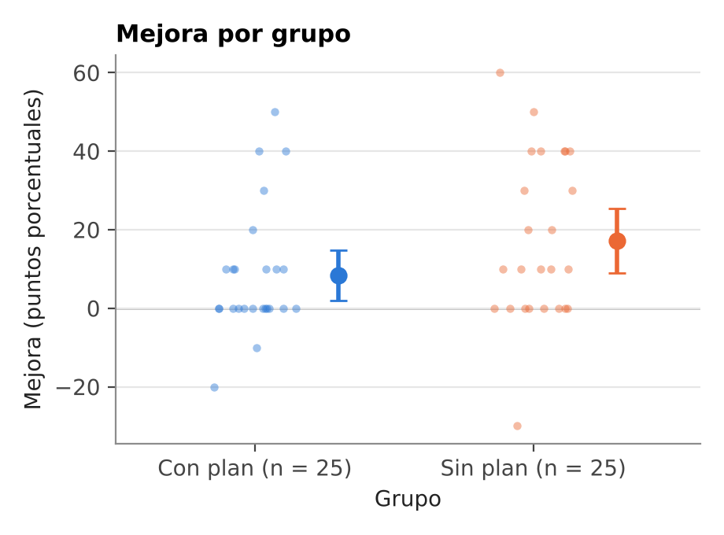 | 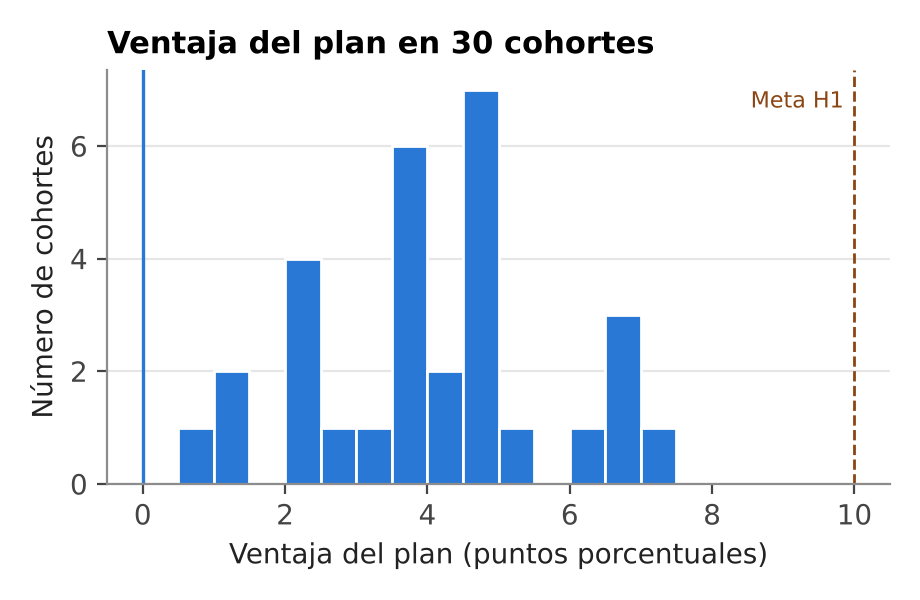 |
| **Dominio estimado frente al estado real** | **Tiempo de cálculo del plan** |
| 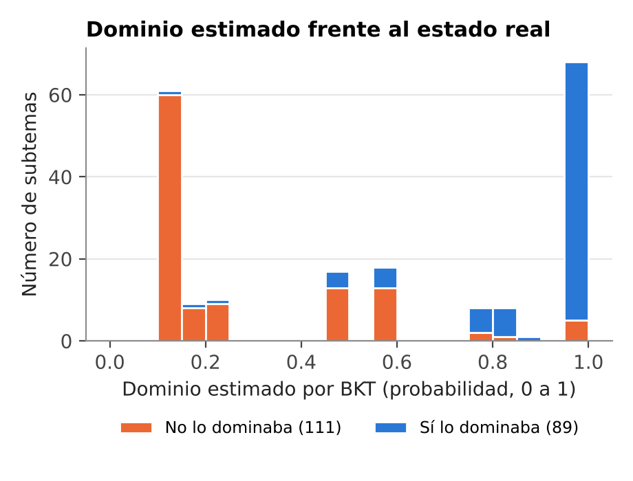 | 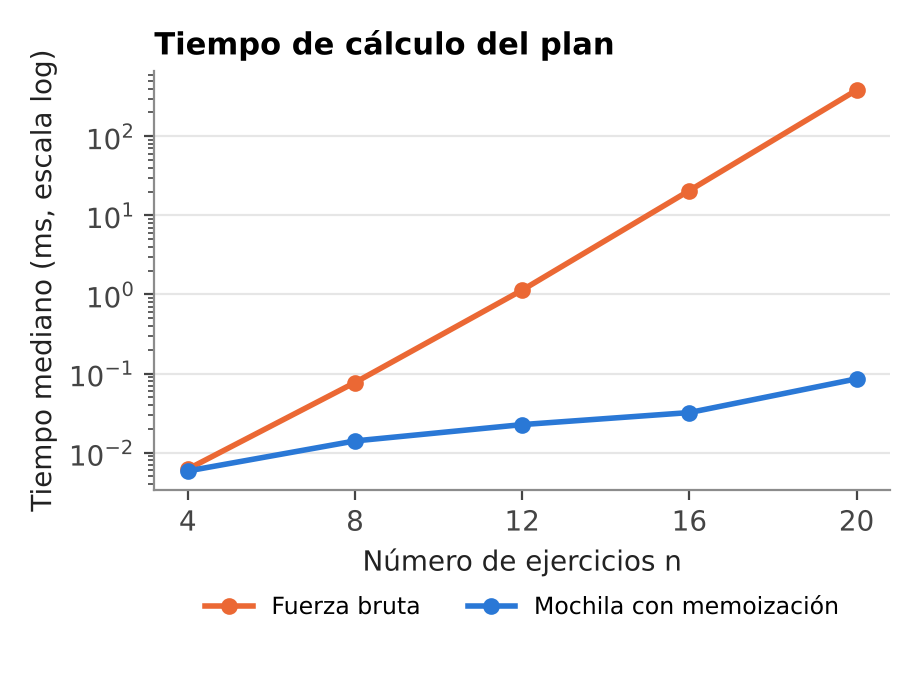 |

## Reproducir los resultados del paper

Todas las cifras y las Figuras 6 a 9 salen de [`simulacion/`](simulacion) con semillas fijas:

```bash
pip install -r requirements-dev.txt
```

```bash
python -m simulacion
```

Tarda unos 10 segundos y escribe en [`simulacion/resultados/`](simulacion/resultados):

| Etapa | Qué reproduce | Archivo |
|---|---|---|
| `python -m simulacion.experimento` | Tabla 10, H1 (Welch, bootstrap, ANCOVA, contrafactual), H2, H3, AUC y Figura 9 | `experimento.json`, `estudiantes.json` |
| `python -m simulacion.robustez` | 30 cohortes de 50 estudiantes (Figura 7) y sensibilidad a la tasa de aprendizaje | `robustez.json` |
| `python -m simulacion.integracion` | Pruebas P-05 a P-07: 50 estudiantes por la aplicación Flask completa, panel docente y CSV | `integracion.json` |
| `python -m simulacion.graficas` | Figuras 6 a 9 | `fig6_mejora.png` … `fig9_tiempos.png` |

Los tiempos dependen del equipo: los del paper se midieron en un Intel Xeon de 2 núcleos a 2,3 GHz con 8 GB de RAM y Python 3.13. Todo lo demás es idéntico en cualquier computador, y la prueba [`tests/test_reproducibilidad.py`](tests/test_reproducibilidad.py) lo verifica en cada cambio.

**Medir los KPIs pendientes (P-04).** En el equipo con LM Studio:

```bash
python probar_lm_studio.py --evaluaciones 20
```

Guarda el tiempo de generación y el porcentaje de evaluaciones válidas en `simulacion/resultados/lm_studio.json`.

## Desarrollo y pruebas

```bash
pip install -r requirements-dev.txt
```

```bash
pytest
```

```bash
ruff check .
```

Las 54 pruebas no necesitan LM Studio (usan un generador falso y una base temporal) y cubren los algoritmos (secuencia del BKT, Tabla 5, mochila contra fuerza bruta en 300 instancias), la validación de la salida de la IA, el flujo web del estudiante y del docente, los KPIs del panel y la reproducción de las cifras del paper. [GitHub Actions](.github/workflows/ci.yml) las ejecuta en Ubuntu y Windows con Python 3.10 y 3.13. Ver [CONTRIBUTING.md](CONTRIBUTING.md).

## Estructura del repositorio

```
├── app.py                 Servidor Flask: rutas del estudiante y del docente
├── ia.py                  Conexión con LM Studio, esquemas JSON y validación
├── bkt.py                 Bayesian Knowledge Tracing
├── beneficio.py           Beneficio de reforzar cada subtema
├── mochila.py             Mochila 0/1 top-down con memoización
├── base_datos.py          SQLite: estudiantes, resultados, progreso_bkt, planes, docentes
├── indicadores.py         KPIs del panel docente
├── config.py              Configuración por variables de entorno
├── probar_lm_studio.py    Diagnóstico de LM Studio y medición de P-04
├── iniciar.bat            Lanzador para Windows
├── iniciar.sh             Lanzador para macOS y Linux
├── templates/             Vistas HTML (Jinja)
├── static/css/            Estilos, sin recursos de Internet
├── simulacion/            Evaluación con estudiantes simulados y sus resultados
├── tests/                 Pruebas automáticas (pytest)
└── docs/                  Paper, sustentación, diagramas y capturas
```

## Límites y trabajo futuro


- El tiempo de generación y el porcentaje de evaluaciones válidas (P-04) deben medirse en el equipo con el modelo: ya está el script para hacerlo.
- Si LM Studio no responde, la evaluación no se crea (la aplicación lo informa y permite reintentar). Un **banco local de preguntas**, que además evite repetir preguntas, es el siguiente paso.
- LM Studio y el modelo todavía se instalan a mano.
- El BKT usa parámetros fijos; con datos de uso se pueden ajustar con EM o probar modelos más complejos.
- Más materias, más ejercicios por subtema y sincronización con el docente cuando haya conexión.

## Equipo

**Juan Pablo León · Mateo Barrios · Santiago Lugo · Alejandro Peña**

Escuela Colombiana de Ingeniería Julio Garavito, Bogotá · Diseño de Datos y Algoritmos · 2026

### Cómo citar

Si usa TutorIA, cite el paper (GitHub ofrece el formato en *Cite this repository*, a partir de [`CITATION.cff`](CITATION.cff)):

> J. P. León, M. Barrios, S. Lugo y A. Peña, «TutorIA: tutor educativo con inteligencia artificial local y programación dinámica para estudiar sin conexión continua a Internet», Escuela Colombiana de Ingeniería Julio Garavito, Bogotá, 2026.

### Referencias principales

- A. T. Corbett y J. R. Anderson, «Knowledge tracing: Modeling the acquisition of procedural knowledge», *User Modeling and User-Adapted Interaction*, 4, 1994.
- K. VanLehn, «The relative effectiveness of human tutoring, intelligent tutoring systems, and other tutoring systems», *Educational Psychologist*, 46(4), 2011.
- J. A. Kulik y J. D. Fletcher, «Effectiveness of intelligent tutoring systems: A meta-analytic review», *Review of Educational Research*, 86(1), 2016.
- T. H. Cormen et al., *Introduction to Algorithms*, 3.ª ed., MIT Press, 2009.
- DANE, *Encuesta de Tecnologías de la Información y las Comunicaciones en Hogares (ENTIC) 2024*, 2025.

La lista completa de 28 referencias está en el [paper](docs/Paper_TutorIA.pdf).

## Licencia

[MIT](LICENSE) © 2026 Juan Pablo León, Mateo Barrios, Santiago Lugo y Alejandro Peña.
